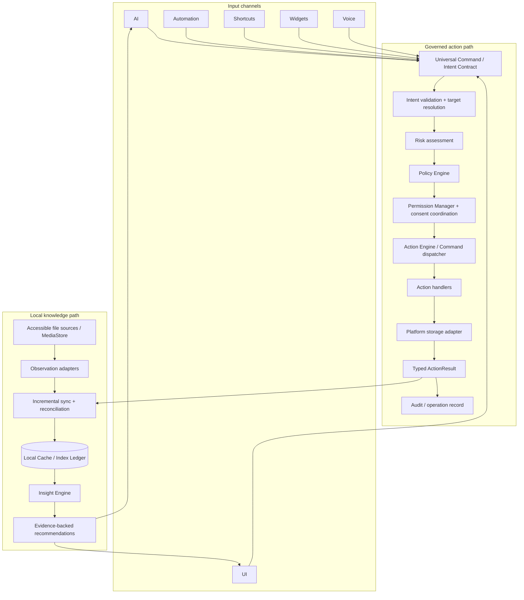

# EdgeLedger Runtime

**Android-first, local-first indexing and insight runtime for Edge AI: incremental file metadata, cascading duplicate detection, and policy-governed actions through a platform-neutral intent contract.**

> **Project status:** Early-stage architecture and proof of concept. The architecture below is the intended design, not a claim that every component is implemented. The Kotlin/Android runtime, persistence layer, synchronization adapters, and policy-enforced action flow still need to be built and tested.

- **Repository name:** `edge-ledger-runtime`
- **Project name:** EdgeLedger Runtime
- **Primary target:** Android devices, with a platform-neutral core as a long-term design goal
- **Primary language for the Android implementation:** Kotlin
- **Prototype language:** Python

## System definition

EdgeLedger Runtime is a local-first data indexing and governed-action runtime for resource-constrained edge devices. It maintains a queryable index of files and metadata that the application is permitted to access, incrementally refreshes that index, and calculates staged file signatures to identify likely duplicates without fully reading every file at the outset.

An **Insight Engine** analyzes the index and produces evidence-backed recommendations. **Universal Command** provides a common, platform-neutral intent contract for AI, UI, automation, shortcuts, widgets, and voice input. A **Policy Engine** evaluates whether an intent is allowed; a separate **Permission Manager** checks operating-system permissions and coordinates required consent; and an **Action Engine** dispatches validated commands to platform-specific storage adapters.

**Core rule: AI proposes intentions. It does not directly perform actions. Only the Action Engine executes validated intentions through an authorized platform adapter.**

## Why this project exists

Repeatedly scanning accessible storage and reading every file can waste I/O bandwidth, CPU time, battery, and memory. EdgeLedger aims to maintain useful local metadata and signatures so common queries—such as finding large files or grouping duplicate candidates—can be answered from the index rather than by rereading every file each time.

The design favors incremental observation where available, bounded background work, staged hashing, explicit permission boundaries, and reconciliation when observations may have been missed. Event-driven observation reduces unnecessary scans; it does **not** remove the need to reconcile the index with the underlying data sources.

## Architecture



### Component responsibilities

| Component | Responsibility | Boundary |
|---|---|---|
| **Observation adapters** | Receive file or media change signals from sources that the app is permitted to observe. | Notifications can be missed or coalesced; they are not a complete truth source. |
| **Synchronization layer** | Apply incremental updates and reconcile the local index when its state may be stale. | Must handle missed events, deleted targets, changed permissions, and provider-version changes. |
| **Index Ledger** | Store queryable file metadata, revision information, and calculated signatures. | It is the local query index, not an infallible source of current filesystem truth. |
| **Cascading Hash Pipeline** | Filter by size, then partial signature, then full-content signature. | Hash results are valid only for the file revision that was actually read. |
| **Insight Engine** | Aggregate indexed data and produce recommendations with supporting evidence. | Read/analyze only; it does not delete, move, or mutate files. |
| **Universal Command** | Normalize requests from AI, UI, automation, shortcuts, widgets, and voice into a common intent contract. | An intent is a request, not an authorization token. |
| **Policy Engine** | Evaluate actions against system policy and risk rules. | Must not rely only on AI self-assessment or hard-coded folder-name checks. |
| **Permission Manager** | Check current OS permissions and coordinate required user consent. | Policy approval does not imply that Android grants access. |
| **Action Engine** | Dispatch validated commands to the appropriate command handler and report structured outcomes. | Orchestration only; avoid centralizing storage and business logic. |
| **Storage adapter / StorageManager** | Translate platform-neutral targets into permitted platform APIs and perform authorized storage operations. | No AI, UI, or policy decisions inside the storage adapter. |

## Core design principles

1. **One command contract.** All input channels express requests using the same platform-neutral intent model.
2. **AI proposes; the system enforces.** AI output is untrusted input and cannot bypass validation, policy, permissions, or consent.
3. **Separate policy from permission.** A policy may allow an operation while Android still denies access.
4. **Platform-neutral core.** Core intents use a `TargetDescriptor`, not Android `Uri` or filesystem paths as their universal identity. Platform adapters resolve the target within their permitted scope.
5. **Incremental first, reconcile when needed.** Use change notifications when available, while retaining a recovery path to rebuild or verify stale index state.
6. **Bounded resource use.** Hash streams in fixed-size chunks, process work in batches, support cancellation, and persist progress before yielding.
7. **No automatic destructive actions.** Duplicate or junk detection produces candidates and recommendations; destructive actions require policy checks and the applicable user approval.
8. **Evidence and status remain explicit.** Record when data was observed and which file revision was hashed. Never present a stale or incomplete index as guaranteed current.

## Cascading duplicate detection

The planned duplicate-detection pipeline uses three stages:

1. **Size correlation:** group files by byte size. A file whose size is unique in the indexed scope cannot be byte-for-byte identical to another file in that scope.
2. **Head-tail partial signature:** for same-size groups, read a bounded sample from the beginning and end of each file. This reduces the number of files that need full reads, but is not proof of equality.
3. **Full-content hash:** hash the remaining candidates by streaming fixed-size chunks. XXH3 is the proposed fast, non-cryptographic option; BLAKE2b may be used in the reference prototype or as a fallback. The algorithm name must be stored with each signature.

A matching non-cryptographic hash is a duplicate **candidate**, not mathematical proof that all bytes are identical. Before a destructive operation, the system should perform exact byte comparison when appropriate, confirm that the target has not changed, and require policy/permission checks. No hashing stage deletes or moves files.

The project does not assume a universal percentage of files will be filtered at each stage. Filter rates, latency, memory use, and energy cost must be measured against real datasets and target devices.

## Intended technology direction

| Area | Intended approach | Status |
|---|---|---|
| Android runtime | Kotlin | Planned |
| Background processing | AndroidX WorkManager with constraints, batching, cancellation, and resumable progress | Planned |
| Local persistence | SQLite, likely accessed through Room in the Android app | Planned |
| Full-text search | SQLite FTS where supported by the selected runtime/build; verify FTS5 availability rather than assume it | Planned |
| File/media observation | Android APIs such as MediaStore observers and FileObserver within permitted access scopes | Planned; coverage and API constraints must be tested |
| Duplicate candidate detection | Size → partial signature → full-content hash | Python reference PoC / Kotlin implementation planned |
| Full hash | XXH3-128 where the selected dependency and device build support it; record the exact algorithm | Planned |
| Policy and actions | Platform-neutral intent contract, policy evaluation, permission handling, typed results, command handlers | Specification in progress |

WAL, `synchronous=NORMAL`, memory mapping, chunk size, batch size, and concurrency settings are tunable parameters—not guarantees of a specific reduction in Write Amplification or energy use. Measure them on target hardware before choosing production defaults. SQLite WAL improves read/write concurrency in common local-database scenarios, but it still has checkpointing and a single-writer constraint.

## Initial test target

The first device-validation target reported for this project has the following profile:

- **Platform:** Android 16
- **CPU:** Snapdragon 8s Gen 4, octa-core, up to 3.21 GHz
- **Physical RAM:** 8 GB (the device also reports 8 GB of memory expansion; do not treat expanded memory as equivalent to physical RAM)
- **Internal storage:** 256 GB capacity
- **Benchmark status:** No performance, energy, thermal, or flash-write measurements have been established yet.

This is a test target, not a minimum requirement. Benchmark conclusions must be tied to the device, OS build, dataset, and test conditions used. Available storage changes over time and should be recorded at the beginning of each test run rather than treated as a fixed specification.

## Implementation status

This repository should distinguish implemented behavior from architecture and research. Use the following labels in issues and documentation:

- **Implemented:** code exists in the repository and passes documented tests.
- **Prototype:** a limited demonstration exists but has not met production requirements.
- **Planned:** described as a future component or contract; not yet implemented.
- **Research:** an assumption or design option that still needs evidence.

At initial repository creation:

- **Architecture:** defined at a high level; contracts need to be stabilized.
- **Python hashing PoC:** reference implementation has been drafted; it should be committed with tests before being labelled a repository prototype.
- **Kotlin / Room / WorkManager:** planned; not yet production-implemented.
- **Android observation and synchronization:** planned; real-device behavior and storage permissions need validation.
- **Benchmarks:** not yet established.
- **Production readiness:** not production-ready.

## Suggested repository layout

```text
edge-ledger-runtime/
├── README.md
├── docs/
│   ├── SYSTEM_DEFINITION.md
│   ├── ARCHITECTURE.md
│   ├── UNIVERSAL_COMMAND_CONTRACT.md
│   ├── POLICY_MODEL.md
│   ├── INDEX_LEDGER_SCHEMA.md
│   └── BENCHMARK_PLAN.md
├── prototypes/
│   └── python/
│       ├── cascading_dedup.py
│       └── tests/
├── android/
│   └── app/
│       └── src/main/
└── benchmarks/
```

This is a proposed layout, not a statement that these files already exist.

## Roadmap

### Phase 0 — Reproducible proof of concept

- [ ] Commit the Python 3-stage deduplication prototype.
- [ ] Add tests for exact duplicates, same-size files with different middle content, unique sizes, empty files, unreadable files, and files that change during hashing.
- [ ] Record stage counts and bytes read; do not claim energy or flash-lifetime improvements without measurements.

### Phase 1 — Stable data contract

- [ ] Define `TargetDescriptor`, `IntentPayload`, action types, intent sources, revision tokens, and typed `ActionResult`.
- [ ] Define Inventory and Signature schemas with migrations and stale-signature invalidation.
- [ ] Define risk, policy, permission, consent, and audit outcomes.

### Phase 2 — Android local index

- [ ] Create the Kotlin application skeleton and Room/SQLite schema.
- [ ] Add source adapters restricted to data the app is permitted to access.
- [ ] Add incremental synchronization plus a reconciliation procedure.

### Phase 3 — Resumable hash worker

- [ ] Implement a single-worker/batched hashing path with cancellation and resumable progress.
- [ ] Integrate and verify the selected XXH3 dependency on the target ABI; keep algorithm identity in the database.
- [ ] Invalidate results when the target revision changes or cannot be verified.

### Phase 4 — Insight and governed actions

- [ ] Build read-only Insight Engine queries and evidence-backed recommendations.
- [ ] Implement Universal Command validation, Policy Engine, Permission Manager, Action Engine, and command handlers.
- [ ] Ensure no direct AI-to-storage execution path exists.

### Phase 5 — Device validation

- [ ] Benchmark realistic file sets on target Android devices.
- [ ] Measure stage latency, bytes read, peak memory, CPU load, thermal behavior, database writes, cancellations, and resume correctness.
- [ ] Verify behavior after permission revocation, missed observations, database recovery, and device restart.

## Security and data-safety boundaries

- Process metadata and content locally by default; network access is not required for the core indexing design.
- Only index files reachable through supported Android APIs and permissions. Do not assume unrestricted access to shared or other-app storage.
- Treat AI-generated intents as untrusted requests. Validate action type, target, revision, policy, and permission independently.
- Keep analysis separate from mutation. The Insight Engine returns recommendations; the Action Engine handles authorized operations.
- Never delete files directly from the deduplication worker.
- Keep audit records useful without unnecessarily storing personal content or sensitive paths.
- Design recovery for stale index entries, missed notifications, interrupted workers, and database-write failures.

## Development notes

No production build or quick-start command is provided yet because the Android application and Gradle project have not been established. Once the project skeleton is committed, this section should document the required JDK, Android SDK, Gradle tasks, test commands, and device setup.

Before public release, add a license file and establish contribution and security-reporting guidance.

## References

- [Android WorkManager — Define work requests and constraints](https://developer.android.com/develop/background-work/background-tasks/persistent/getting-started/define-work)
- [Android shared media storage and MediaStore](https://developer.android.com/training/data-storage/shared/media)
- [SQLite Write-Ahead Logging](https://www.sqlite.org/wal.html)
- [SQLite FTS5](https://www.sqlite.org/fts5.html)
- [xxHash project](https://github.com/Cyan4973/xxHash)

---

## คำอธิบายภาษาไทย

**EdgeLedger Runtime** คือสถาปัตยกรรมสำหรับสร้างดัชนีข้อมูลไฟล์ภายในอุปกรณ์ วิเคราะห์ข้อมูล และเสนอการดำเนินการให้ระบบที่ผ่านการตรวจสอบแล้ว โดยเริ่มจาก Android และออกแบบแกนกลางให้ไม่ผูกกับแพลตฟอร์มเดียว

ระบบแบ่งหน้าที่ระหว่าง Index Ledger, Insight Engine, Universal Command, Policy Engine, Permission Manager, Action Engine และ Storage Adapter อย่างชัดเจน AI มีหน้าที่เสนอเจตจำนงเท่านั้น ไม่เรียก API เพื่อเปลี่ยนแปลงไฟล์โดยตรง การกระทำจริงต้องผ่านการตรวจสอบนโยบาย สิทธิ์ และความยินยอมที่จำเป็น

สถานะปัจจุบันเป็นงานระยะเริ่มต้น: มีแนวทางและ Python PoC ที่ร่างไว้ แต่ยังต้องนำเข้า repository เพิ่มการทดสอบ และพัฒนา Kotlin/Android runtime ก่อนอ้างว่าใช้งานจริงได้
